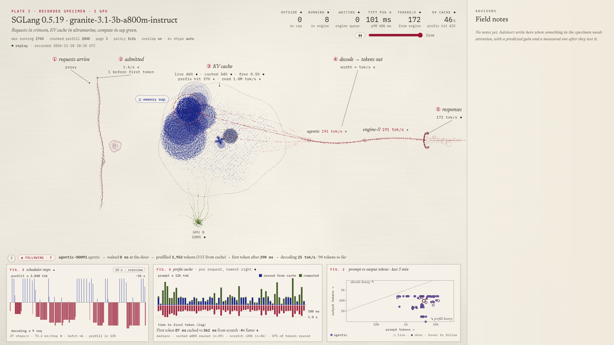

# inference-observe

A live view inside an LLM inference engine. Every request, scheduler step, KV-cache block and expert
hit from **SGLang** or **vLLM** is drawn as it happens, and advisor agents post tuning proposals next
to the evidence.



Video (24 s): [docs/demo.mp4](docs/demo.mp4), SGLang 0.5.19 on one RTX 4060 Ti, agent traffic from the
Mooncake production trace.

## What the board shows

| On the board | Signal | Source |
|---|---|---|
| Crimson cells on the left | requests waiting at the proxy, then admitted into the engine | proxy |
| Blue colonies inside the body | each running request's own KV cache, to scale against the KV pool | tap |
| Dark core with rings | a prompt prefix shared by several running requests: one copy in memory, many readers | tap, proxy |
| Hatched field | prefixes kept in cache for reuse (allocated, no running request) | tap |
| Memory map (press **M**) | the KV pool cell by cell: a request's own tokens, shared prefixes, cached, free | tap (SGLang) |
| Crimson veins | generated tokens leaving, per traffic class and per engine instance; width = tokens/s | proxy |
| Green neurons | GPUs; they fire on each scheduler step | NVML, tap |
| Fig. 3 | every scheduler step: prefill tokens up, decoding requests down | tap |
| Fig. 4 | dense models: tokens reused from cache vs computed, and time to first token, per request. MoE models: load on the busiest expert of each layer | proxy, tap |
| Fig. 2 | prompt vs output tokens per request (prefill-heavy vs decode-heavy) | proxy |
| Field notes | advisor proposals: evidence, a config change, the predicted effect | advisors |

Every number carries a mark: ● measured by the engine, ◐ derived from measured values, ○ estimated.
Signals the engine does not report stay blank. Press **?** on the board for the key, **F** to follow
one request through the engine, scroll to zoom, click anything to inspect it.

## Quick start: replay a recording

Needs Node 20 or later.

```bash
cd board
npm install
npm run dev
```

Open <http://127.0.0.1:18300/?replay=/samples/sglang-mooncake-agent.jsonl&loop=1>.

The sample is a recording of SGLang 0.5.19 serving granite-3.1-3b-a800m-instruct on one RTX 4060 Ti,
with agent traffic from the Mooncake trace (see [Workloads](#workloads)).

## Connect SGLang

Tested with SGLang 0.5.19 and 0.5.23.

1. Install the tap into SGLang's Python environment. SGLang loads it through its plugin entry point.

   ```bash
   pip install -e taps
   ```

2. Start SGLang with metrics and cache reporting. `IO_TAP_URL` is this server's address; the collector
   uses it to match engine data with proxy traffic.

   ```bash
   IO_TAP_URL=http://127.0.0.1:30000 python -m sglang.launch_server \
     --model-path Qwen/Qwen3-4B-Instruct-2507 --port 30000 \
     --enable-metrics --enable-cache-report
   ```

3. Install the harness in its own environment (Python 3.12) and start the proxy and the collector.

   ```bash
   uv venv && source .venv/bin/activate && uv pip install -e .
   io-proxy --upstream http://127.0.0.1:30000 --rid-in-body &
   io-collector --engine sglang --engine-url http://127.0.0.1:30000 --gpus 0 --out runs/live &
   ```

4. Start the board and open <http://127.0.0.1:18300/>.

   ```bash
   cd board && npm install && npm run dev
   ```

5. Send requests to the proxy: `http://127.0.0.1:18000/v1/chat/completions`. An `X-Workload: <name>`
   header gives a request a traffic class on the board.

The board's header shows `SGLang <version> · <model>` and `live`. The collector records everything to
`runs/live/collector.jsonl`.

**Expert routing (MoE models).** Start SGLang with its expert recorder, then run the sampler with
SGLang's Python from the repository root. It works with models whose SGLang implementation records
layer indices (Qwen-MoE, DeepSeek).

```bash
SGLANG_EXPERT_DISTRIBUTION_RECORDER_DIR=/tmp/io-moe IO_TAP_URL=http://127.0.0.1:30000 \
  python -m sglang.launch_server --model-path Qwen/Qwen3-30B-A3B-Instruct-2507 --port 30000 \
  --enable-metrics --enable-cache-report --expert-distribution-recorder-mode stat
python -m harness.moe_sampler --engine-url http://127.0.0.1:30000 --dir /tmp/io-moe \
  --model Qwen/Qwen3-30B-A3B-Instruct-2507
```

## Connect vLLM

Tested with vLLM 0.32 and 0.34.

1. Install the tap into vLLM's Python environment. vLLM loads it as a stat logger.

   ```bash
   pip install -e taps
   ```

2. Start vLLM with per-step details and cached-token reporting.

   ```bash
   IO_TAP_URL=http://127.0.0.1:8000 vllm serve Qwen/Qwen3-4B-Instruct-2507 --port 8000 \
     --enable-logging-iteration-details --enable-prompt-tokens-details
   ```

3. Start the proxy and the collector.

   ```bash
   io-proxy --upstream http://127.0.0.1:8000 &
   io-collector --engine vllm --engine-url http://127.0.0.1:8000 --gpus 0 --out runs/live &
   ```

4. Start the board and send requests to the proxy, as for SGLang.

### What each tap reports

| | SGLang | vLLM |
|---|---|---|
| Per step: prefill and decode work, running, waiting, KV usage | yes | yes |
| Per step: which requests were in the batch | yes | no |
| Per request: queue, prefill and decode time, cached tokens | yes | yes |
| Prefix-cache lookups and hits | yes | yes |
| Speculative decoding drafts and acceptance | yes | yes |
| KV memory map | yes | no |
| Expert routing | yes, with the sampler | no |

## Multi-GPU and multi-node: connect to rank 0

The tap loads in every engine process, but only one process per engine instance sends data:

- **SGLang**: the reporting rank (pipeline rank 0, attention tensor-parallel rank 0, attention
  context-parallel rank 0), the same rank SGLang uses for its own metrics. It runs on node 0. With
  data parallelism, each DP rank reports as a separate instance, `<instance>.dp<N>`.
- **vLLM**: the tap is a stat logger in the API server, which runs on the head node and receives the
  stats of every engine. Data-parallel engines report as `<instance>.dp<N>`.

The collector only needs to reach node 0. Example: SGLang on two nodes of 8 GPUs, tensor parallel 16.

1. On both nodes, install the tap into SGLang's environment: `pip install -e taps`. Ranks other than
   the reporting rank load it and send nothing.

2. Start node 0.

   ```bash
   IO_TAP_URL=http://<node0>:30000 python -m sglang.launch_server --model-path <model> \
     --tp 16 --nnodes 2 --node-rank 0 --dist-init-addr <node0>:5000 \
     --host 0.0.0.0 --port 30000 --enable-metrics --enable-cache-report
   ```

3. Start node 1 with the same command and `--node-rank 1`.

4. On node 0, start the proxy and the collector against node 0's server.

   ```bash
   io-proxy --upstream http://127.0.0.1:30000 --rid-in-body &
   io-collector --engine sglang --engine-url http://127.0.0.1:30000 --gpus 0,1,2,3,4,5,6,7 --out runs/live &
   ```

5. On your machine, forward the two ports, start the board and send requests to `http://127.0.0.1:18000`.

   ```bash
   ssh -N -L 18200:127.0.0.1:18200 -L 18000:127.0.0.1:18000 <node0>
   ```

- To run the collector on another machine, set `IO_TAP_HOST=<collector host>` on node 0 (default
  `127.0.0.1`).
- With data parallelism across nodes, DP ranks on other nodes report too: set `IO_TAP_HOST` on every node.
- GPU telemetry covers the GPUs of the machine that runs the collector.
- vLLM across nodes (Ray, or data parallel with `--headless` workers): install the tap on the head node
  and start the proxy and the collector there, against the API server.

Tested on one node: vLLM with tensor parallel 2, data parallel 2, two replicas, and prefill/decode
disaggregation over NIXL; SGLang on one GPU. Not yet run across nodes.

## Advisors

```bash
io-advisor --collector ws://127.0.0.1:18200/ws --post http://127.0.0.1:18200/note
```

The advisor watches the stream and posts proposals under Field notes, each with its evidence, a config
change for the running engine and the predicted effect. Examples: requests queue because the KV cache
is full; shared prefixes are recomputed. Any tool can post notes: see [docs/events.md](docs/events.md).

## Workloads

Replay a trace through the proxy. Requests are sent at their scheduled times, so overload shows up as
queueing.

```bash
io-replay traces/<trace>.jsonl --base http://127.0.0.1:18000 --out runs/live --no-salt
```

**Production traffic (Mooncake).** Mooncake's open traces (Kimi, FAST '25) give, per request, the arrival
time, the input and output lengths and one hash ID per 512-token prompt block. `io-mooncake` turns each
hash ID into a fixed block of text, so prompts share prefixes exactly where the originals did.

```bash
curl -LO https://raw.githubusercontent.com/kvcache-ai/Mooncake/main/FAST25-release/traces/toolagent_trace.jsonl
io-mooncake toolagent_trace.jsonl --out traces/mooncake-agent.jsonl \
  --block-tokens 256 --duration 70 --stretch 3.5 --max-input 12000 --max-output 256 --spread
```

`--block-tokens` and `--stretch` scale the trace to a smaller GPU. The trace records arrivals at
3-second resolution; `--spread` places each timestamp's requests evenly across those 3 seconds. The
sample and the video use the values above. Replay Mooncake traces with `--no-salt`, which keeps the
prompts as written.

**Synthetic workloads.** `io-traces --out traces` builds chat, agentic, RAG, burst and speculative
workloads from MATH-500 prompts. By default `io-replay` makes each replay's prompts unique, so a
repeated replay starts with a cold cache.

## Recordings

- The collector writes `<out>/collector.jsonl`.
- Replay it in the browser: copy it to `board/public/samples/` and open `?replay=/samples/<file>.jsonl&loop=1`.
- Or serve it like a live collector: `io-replay-ws runs/live --loop`, then open the board as usual.

## Reference

| Port | |
|---|---|
| 18000 | proxy (OpenAI-compatible) |
| 18200 | collector: board stream `ws://…/ws`, `POST /note`, `GET /health` |
| 18201/udp | collector: tap datagrams (`IO_TAP_HOST`, `IO_TAP_PORT`) |
| 18300 | board |

Board URL parameters: `?ws=ws://<host>:<port>/ws`, `?replay=<url>&loop=1&speed=2`,
`?mock=steady|burst|pd|rep` (synthetic data, labelled as such on the board).

Tap environment: `IO_TAP_URL` (this server's address), `IO_TAP_INSTANCE` (instance name, default
`engine`), `IO_TAP_HOST` and `IO_TAP_PORT` (collector), `IO_KV_MAP_EVERY` (seconds between KV maps,
default 1).

| Path | |
|---|---|
| `taps/` | engine plugins: SGLang (`sglang.srt.plugins`) and vLLM (`vllm.stat_logger_plugins`) |
| `harness/` | proxy, collector, advisor, replay tools, trace converters, expert sampler |
| `board/` | the board (TypeScript, WebGL2, Vite); `scripts/evaluate.mjs` is its visual test suite |
| `docs/events.md` | the event format |

Board checks: `cd board && npx tsc --noEmit -p . && BOARD_URL=http://127.0.0.1:18300/ node scripts/evaluate.mjs`
(Playwright with Chrome).

## License and data

Apache-2.0. Mooncake traces: [kvcache-ai/Mooncake](https://github.com/kvcache-ai/Mooncake). Synthetic
workloads: [MATH-500](https://huggingface.co/datasets/HuggingFaceH4/MATH-500).
